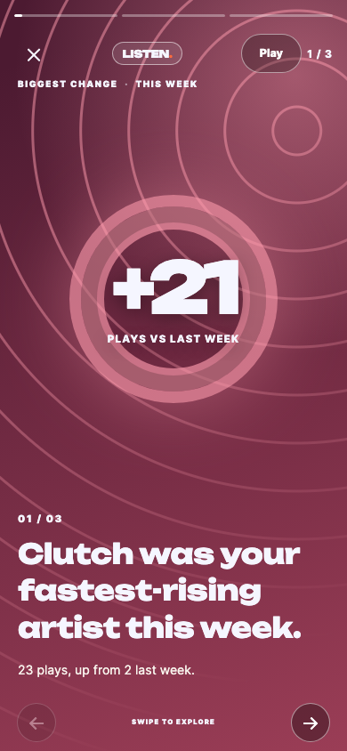
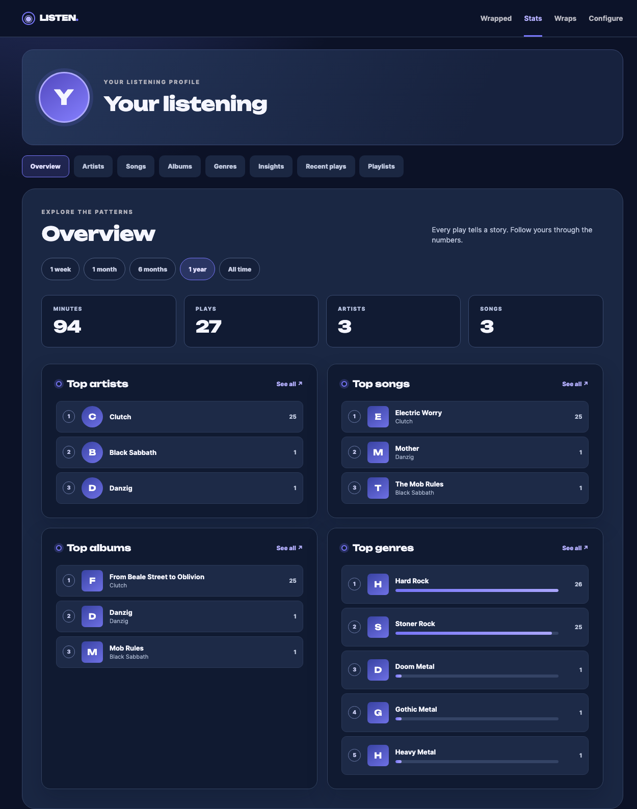

# Your Spotify Wrapped

A private, single-person listening journal for your Mac. Import your Spotify
history, connect Spotify for recent plays and playlists, and make three
swipeable cards for a week, month, six months, year, or all time. The Stats
dashboard shows your favourite artists, songs, albums, genres, listening times,
playlists, and recent plays. Your database stays on your Mac.

 

## What you need

- A Mac and about 30 minutes for setup. You will need your Mac password to
  install Herd.
- Spotify Premium to create and use a Spotify Development Mode app.
- Your Spotify data export. Request it first because the extended history may
  take up to 30 days.

| Information | Where to find it | Where it goes |
| --- | --- | --- |
| Spotify Client ID and Client Secret | [Spotify Developer Dashboard](https://developer.spotify.com/dashboard) → your app → Settings | `.env` |
| Redirect URI | Use `https://spotify-wrapped.test/spotify/callback` exactly | Spotify app Settings and `.env` |
| Timezone | Your local timezone, such as `Europe/London` | `.env` |
| Spotify email, only if Spotify says “user not registered” | Your Spotify Account page | Developer Dashboard → User Management |
| Anthropic API key, optional | [Anthropic Console](https://console.anthropic.com/) | `.env` |

You do **not** put your Spotify username or password in this app. You sign in on
Spotify's own page.

## Set up, step by step

### 1. Request your Spotify data

Visit [Spotify Privacy](https://www.spotify.com/account/privacy/) and choose
**Download your data**. Select **Extended streaming history** and **Account
data**, then request the data and confirm using the email Spotify sends. Account
data usually arrives first and covers roughly the past year; extended history
can take up to 30 days and covers your whole account. Download the ZIP within 14
days of Spotify's delivery email. You can start with Account data and import the
extended files later.

### 2. Install Laravel Herd and PHP

Download [Laravel Herd](https://herd.laravel.com/), move it to Applications, and
open it. The free version is enough. In Herd → Settings → PHP, install **PHP
8.5** and set it as the default. Reopen Terminal and run:

```sh
php -v
composer -V
```

The PHP line must say **8.5**. If Terminal cannot find `composer`, reopen
Terminal after Herd is running.

### 3. Put this folder in Herd

Download this repository as a ZIP and unzip it into `~/Herd`. Rename the
resulting folder to **`spotify-wrapped`**; a GitHub ZIP often ends in `-main`.
The folder name determines the `.test` address. If you use Git instead, clone
this repository directly to `~/Herd/spotify-wrapped`.

### 4. Install the app

In Terminal:

```sh
cd ~/Herd/spotify-wrapped
composer run setup
```

This installs PHP packages, creates `.env` with a private encryption key, and
creates the SQLite database. Success ends with **Nothing to migrate** or
**Running migrations**, without an error. You can run `composer run setup` again
after an update; it preserves your encryption key and data.

### 5. Turn on HTTPS

```sh
herd secure spotify-wrapped
```

Or use Herd → Sites → `spotify-wrapped` → Secure. Open
[https://spotify-wrapped.test](https://spotify-wrapped.test) on your Mac. If
Herd asks to trust its certificate, follow its prompts.

### 6. Create a Spotify developer app

Sign into the [Spotify Developer
Dashboard](https://developer.spotify.com/dashboard) with the Premium account you
listen with. Accept the developer terms and choose **Create app**. Give it any
name and description. Add this **Redirect URI**, exactly as shown, then click
**Add**:

```text
https://spotify-wrapped.test/spotify/callback
```

Select **Web API** and save. In the app's Settings, copy the **Client ID** and
reveal the **Client Secret**. Treat the secret like a password. If Spotify says
your account is not registered, add your own Spotify account email under **User
Management**.

### 7. Enter your settings

Open the hidden `.env` file with TextEdit:

```sh
open -e ~/Herd/spotify-wrapped/.env
```

Fill in these lines. Do not add quotes or spaces around the values:

```dotenv
SPOTIFY_CLIENT_ID=your_client_id
SPOTIFY_CLIENT_SECRET=your_client_secret
SPOTIFY_REDIRECT_URI=https://spotify-wrapped.test/spotify/callback
WRAPPED_TIMEZONE=Europe/London
```

Save the file. Change the timezone if you live elsewhere. Run `php artisan
config:clear` if the app continues to show old settings.

### 8. Connect Spotify

Open the app **on your Mac**, go to **Configure**, click **Connect Spotify**,
then agree on Spotify's page. The app should show “Connected to Spotify as …”
and fetch recent plays. It requests `user-read-recently-played`,
`playlist-read-private`, and `playlist-read-collaborative` permissions. A 403
usually means the developer app owner needs Premium, or your account needs to be
added under User Management.

### 9. Import your history

Unzip Spotify's download. Copy the `Streaming_History_Audio_*.json` or
`StreamingHistory_music_*.json` files into `~/Herd/spotify-wrapped/import/`. You
can copy the whole unzipped folder; the importer searches inside subfolders.
Click **Import files** on Configure. For a large history, use Terminal to avoid
a browser timeout:

```sh
cd ~/Herd/spotify-wrapped
php artisan wrapped:import
```

The importer skips podcasts, audiobooks, and plays shorter than 30 seconds.
Importing the same files again is safe. Where sources overlap, extended history
wins over Account data, and both win over API plays. Your original ZIP is a
useful backup.

### 10. Make a Wrapped

Choose a period on the home page and click **Generate Wrapped**. Regenerating a
period on the same day refreshes the same URL and keeps its colour. When you
open the app, it also creates a weekly Wrapped automatically if there are plays
in the past week and no recent weekly Wrap. Home shows your three newest
stories; **Wraps** holds the full archive. Each saved story gets its own colour.
Use the trash icon on a card to open a delete confirmation.

## Using the app

### The three cards

1. **Biggest Change** compares this period with the preceding period. It can
   show a big change in minutes or an artist that rose or fell.
2. **New Discovery** picks an artist you first heard recently. Importing full
   history makes this more accurate; recent API plays alone can make familiar
   artists look new.
3. **Weekly Summary** turns the listening facts into one sentence. Without a
   Spotify connection, it still uses plays and artists; genres and photos appear
   after enrichment.

Stories advance every nine seconds. Use **Pause** or **Play** in the story
header to control playback; reduced-motion settings start playback paused. On a
phone, swipe or tap the left or right third of a card. On a computer, use the
arrow keys or the on-screen buttons. `Esc` or a click outside the card frame
closes the deck and returns to Wraps. The close link works without JavaScript.
You can link straight to a card by adding `#card-2` or `#card-3` to its URL.

Use **Download** while viewing a card to save that story as a 1080 × 1920 image
for an Instagram Story. The download includes the card's text and artwork when
the image is available.

### Stats dashboard

Use **Stats** in the top navigation. **Overview** shows the leading artists,
songs, albums and genres. The four **See all** tabs show longer lists.
**Insights** shows when you listen, new versus familiar artists, decades and
song lengths. **Recent** shows the latest 50 plays. **Playlists** reads your
current Spotify playlists when connected; older connections need to reconnect on
Configure to grant the new permissions. Change the period using the pills near
the top; **This year** is the default.

Photos, covers, genres and release years come from Spotify. The app fetches up
to 20 uncached details per dashboard page, so a refresh or two may fill in more
images. They require a connected account. Spotify no longer provides the audio
features, popularity or follower data needed for volt.fm style mood sliders,
popularity charts or follower counts; this dashboard uses listening history
instead.

## Keep it updated

Spotify's recently played API returns only the latest **50 plays**. If you
listen heavily, that may cover only a few hours. The app syncs when you open
Configure, at most once every 15 minutes. You can also click **Sync now** there.

For more frequent automatic sync, leave this command running in a Terminal
window while your Mac is awake:

```sh
cd ~/Herd/spotify-wrapped
php artisan schedule:work
```

The schedule syncs hourly and generates a weekly Wrapped on Monday at 07:00 in
your configured timezone. To run it with macOS cron instead, add this line using
`crontab -e` (replace `YOURNAME` with your Mac username):

```cron
* * * * * cd /Users/YOURNAME/Herd/spotify-wrapped && /Users/YOURNAME/Library/Application\ Support/Herd/bin/php artisan schedule:run >> /dev/null 2>&1
```

Use `crontab -e` again and delete the line to remove it. Cron runs only while
the Mac is awake. If you miss plays, request a fresh export and import it again.

### View it on your phone

On your Mac, run:

```sh
cd ~/Herd/spotify-wrapped
php artisan serve --host=0.0.0.0 --port=8000
```

Find the Mac's local IP in System Settings → Wi-Fi → Details. On a phone on the
same Wi-Fi, visit `http://YOUR-MAC-IP:8000` and use **Add to Home Screen**.
Allow incoming connections if macOS asks. This address has **no login**, so use
it only on a trusted home network. Connect Spotify from the Mac, where the
registered redirect URI works.

## Optional AI summary

The summary sentence is generated from deterministic rules by default. If you
add `ANTHROPIC_API_KEY` to `.env`, Claude can rewrite only that sentence using
the same facts. Set `ANTHROPIC_MODEL=claude-haiku-5-5` for a lower-cost model.
It makes a paid API request when generating a Wrapped, generally on the order of
pennies or less. If the request fails, the rule-based sentence remains. Run `php
artisan config:clear` after changing `.env`.

## Back up and update

To back up the database:

```sh
cp database/database.sqlite ~/Desktop/wrapped-backup-$(date +%F).sqlite
```

Keep your `.env` and original Spotify ZIPs too. With Git, update using `git pull
&& composer run setup`. With ZIPs, rename the old folder, unpack the new
version, and copy `.env`, `database/database.sqlite`, and `import/` into it
before running `composer run setup`. Do not let Finder replace the old folder
wholesale.

Everything is stored locally in SQLite, except Spotify API calls and optional
Anthropic requests. To revoke Spotify access, use [Spotify account
apps](https://www.spotify.com/account/apps/). The app asks for recent plays and
playlist read access.

## Troubleshooting

| What you see | What to do |
| --- | --- |
| `command not found: composer` | Open Herd, then reopen Terminal. |
| `requires php ^8.5` or your PHP version is wrong | Install PHP 8.5 in Herd, set it as default, and reopen Terminal. |
| Site cannot be reached | Check Herd is running and the folder is exactly `spotify-wrapped` inside `~/Herd`. |
| Browser says the site is not private | Secure the site in Herd and trust its certificate. |
| `INVALID_CLIENT: Invalid redirect URI` | Make the URI in Spotify Settings and `.env` identical, including `https`, folder name, and `/spotify/callback`. Use the Mac address to connect. |
| Invalid client or secret | Copy the ID and secret again from Spotify Settings. Do not include spaces or quotes. |
| “Spotify refused access” or a 403 | Make sure the developer app owner has Premium and your email is in User Management. |
| Sign-in expired or revoked | Click **Connect Spotify** again. |
| “Could not be verified” | Start at the same `.test` address used in the registered redirect URI. |
| cURL error 6 | Check that the Mac is online. |
| Rate limited | Wait for the number of seconds shown, then sync again. |
| Stats show initials instead of images | Connect Spotify, then refresh; at most 20 details are fetched per page. |
| No files found | Put `Streaming_History_Audio_*.json` or `StreamingHistory_music_*.json` in `import/`, then retry. |
| Import times out or runs out of memory | Use `php artisan wrapped:import` in Terminal. |
| Database is locked | Stop a concurrent import or sync and retry. |
| Bad timezone | Use a timezone such as `Europe/London`, then clear config. |
| Missing encryption key | Run `composer run setup`. Keep your old `.env` when updating so saved tokens can be decrypted. |
| Database file does not exist | Run `composer run setup`. |
| `.env` changes seem ignored | Run `php artisan config:clear`. |
| Port 8000 is already in use | Stop the other server or use another port in the `serve` command. |
| Phone cannot connect | Put both devices on the same Wi-Fi, keep the Terminal server running, and allow incoming connections. |

For other failures, look at `storage/logs/laravel.log`.

## For developers

The app uses PHP 8.5, Laravel 13, SQLite, Blade, and plain CSS/JavaScript. There
is no Node build. `app/Services/HistoryImporter.php` maps exports to `plays`;
`app/Services/Spotify.php` handles OAuth and recent plays;
`app/Services/Stats.php` shares queries between the cards in
`app/Wrapped/WrappedBuilder.php` and `StatsController`. The database is
`database/database.sqlite`.

Useful commands:

```sh
php artisan wrapped:import
php artisan wrapped:sync
php artisan wrapped:generate week
php artisan test
```

Without Herd, use `php artisan serve` on **127.0.0.1**, never `localhost`, and
register `http://127.0.0.1:8000/spotify/callback` in Spotify alongside matching
`APP_URL` and `SPOTIFY_REDIRECT_URI` values. Flock and Valet also work. The
deliberate shortcuts are marked `ponytail:` in source (`rg 'ponytail:' app`).
